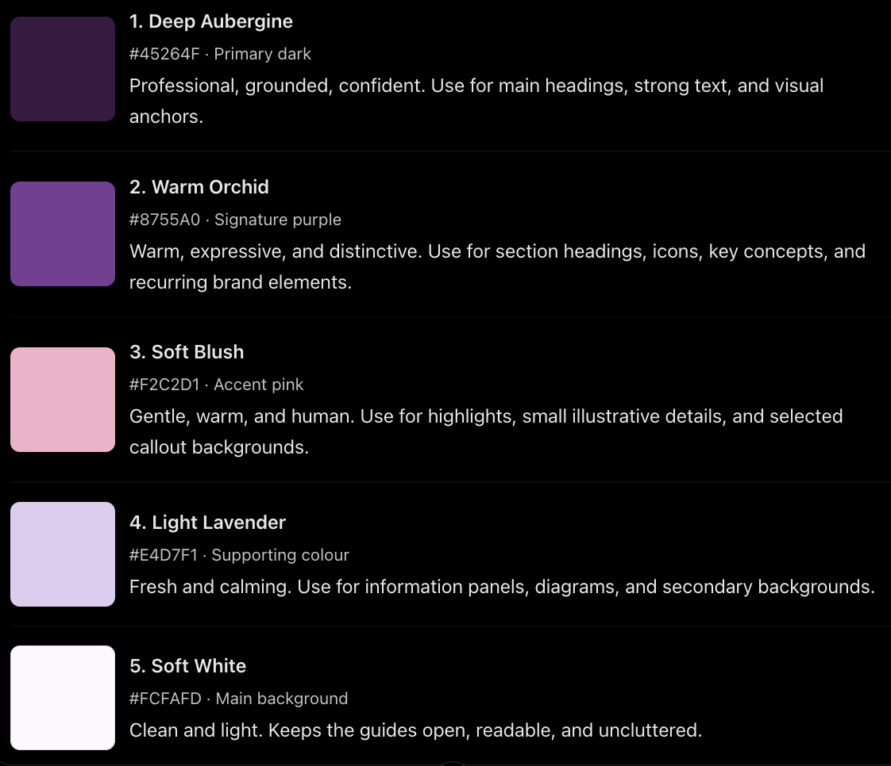
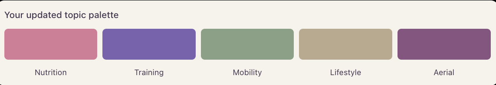

# Visual identity lookbook

## EBOOK & COACHING GUIDE

### VISUAL IDENTITY LOOKBOOK

**Brand/author:** Strong with Marce

**Document version:** 1.0

**Date:** 13/10/2026

**Purpose:** To establish a consistent visual identity and design system for all ebooks, coaching guides, and educational resources produced under this brand.

---

## 1. BRAND ESSENCE

### 1.1 Brand purpose

This brand exists to help people move and feel better, build confidence in their bodies, and enjoy an active life. We believe that understanding how to eat, exercise, and recover empowers people to improve their physical performance, build lasting healthy habits, and support their long-term health.

Through our guides and e-books, we bridge the gap between scientific knowledge and everyday practice, turning complex information into clear, practical guidance that anyone can understand and apply to their lives.

### 1.2 Target audience

The brand serves two primary audiences.

**Everyday health and fitness:** Busy, midlife professionals who are new to structured exercise and nutrition, or who understand the basics but struggle to apply them consistently. They need clear, evidence-based, practical guidance that helps them build sustainable routines around their work, family, and other commitments. They want to feel healthier, stronger, more energetic, and capable in everyday life.

**Aerialists:** Beginner and intermediate aerial practitioners who want to develop the strength, mobility, control, and physical capacity needed to support their practice. They need targeted, accessible guidance on conditioning, prehabilitation, and complementary exercises that help them prepare for the demands of aerial training and develop their skills.

Both audiences value practical knowledge they can apply directly to their lives and training. The brand translates complex concepts into clear, structured, actionable resources without unnecessary jargon or overwhelming detail.

### 1.3 Brand architecture

**Brand structure: Personal brand with dedicated product collections**

The brand is built around Marcela Viola as a personal trainer, coach, and aerialist. All educational resources and digital products will be published under this personal brand, leveraging the trust, expertise, and community already established through coaching and teaching.

The ebooks and coaching guides will form a cohesive product collection with a consistent visual identity, recognizable design elements, and a clear connection to the parent brand.

The design system should be flexible enough to accommodate different subject areas, including everyday health and fitness, nutrition, strength training, recovery, and aerial conditioning. Individual collections may use distinct visual accents while retaining the core brand identity.

The objective is to create professional, recognizable educational products that can grow alongside the coaching business without requiring a separate standalone brand.

### 1.4 Brand promise

Our guides help people understand nutrition and training and turn that knowledge into practical actions they can apply to everyday life. Readers should feel more confident in their choices, better equipped to build healthy habits, and prepared to take on the demands of the day feeling stronger, more energised, and capable.

Our promise is to make evidence-based information clear, practical, and useful — so readers can move beyond simply knowing what to do and start putting it into practice.

### 1.5 Brand personality

**Fresh**
The design feels light, modern, and refreshing. Pages have enough white space to let the information breathe, with a balanced use of colour and visual elements. The overall experience feels inviting rather than dense or overwhelming.

**Clean**
Information is organised into clear sections with a strong visual hierarchy. Typography, spacing, and layouts make the content easy to read and understand, without unnecessary decoration or visual clutter.

**Professional**
The brand communicates expertise and credibility through accurate, evidence-based information and thoughtful design. The visual identity feels polished and trustworthy without being clinical, cold, or overly formal.

**Practical**
Everything serves a purpose. Writing is direct and accessible, without unnecessary jargon or lengthy explanations. Clear headings, summaries, examples, and actionable steps help readers quickly find what they need and apply it in real life.

**Strong**
The brand empowers people by giving them the knowledge and tools to take ownership of their health and physical development. It communicates capability, confidence, and progress—not perfection. The visual identity should feel grounded and purposeful rather than delicate or passive.

**How these qualities translate into design:**
Fresh + Clean
Generous white space, clear page layouts, readable typography.

Professional + Practical
Consistent heading styles, structured information, useful diagrams, checklists, practical examples, and clear action steps.

Strong
Confident typography, purposeful contrast, defined visual accents, and imagery that communicates movement, capability, and real people doing real things.

### 1.6 Desired reader experience

**When opening the guide**
Readers feel interested and motivated to explore the content. The design is appealing, fresh, and professional, inviting them in without feeling intimidating or overly technical.

**While reading**
The information feels clear, accessible, and easy to follow. Content is broken into manageable sections, with enough explanation to create a genuine sense of learning without overwhelming the reader. The experience feels engaging and effortless, even when the subject is new to them.

**When finishing the guide**
Readers feel more knowledgeable, confident, and ready to take action. They understand what they have learned, know how to apply it to their own lives, and have a clear starting point and practical action plan.

**The overall goal:** Every guide should turn complex information into an enjoyable learning experience that leaves readers thinking, *“I understand this now, and I know what to do next.”*

### What this means for the design

I'd translate this into four practical design principles:

- Easy to enter: An inviting cover, clear title, and an immediate sense of what the reader will gain.
- Easy to navigate: Descriptive headings, short sections, meaningful visuals, and a clear progression of ideas.
- Easy to learn from: Useful examples, diagrams, summaries, and explanations that make concepts click.
- Easy to act on: A final checklist, action plan, or clearly defined first step.

## 2. OVERALL LOOK & FEEL

### 2.1 Visual direction

The brand communicates expertise and credibility through a modern, active, engaging visual identity.

The design balances a fresh, minimal aesthetic with strong, confident elements; purposeful use of colour, typography, and imagery adds energy and character.

The content feels thoughtful and carefully curated. Every visual element serves a purpose, supporting the message.

The overall impression is inspiring and empowering without being intimidating. The design encourages readers to learn, take action, and feel confident in their ability to improve their health and physical performance.

### 2.2 Design keywords

- Empower
- Active
- Confident
- Movement
- Meaningful

### 2.3 Visual balance

**Minimalist or information-dense: Balanced, leaning towards minimalist.**
Prioritise concise, carefully curated information. Use enough white space to make pages feel light and readable, without removing the detail readers need to understand the subject.

**Calm or energetic: Energetic.**
The design should communicate momentum, capability, and motivation. Readers should feel that they have a clear plan and are ready to take action. Energy should come from purposeful colour, typography, and layout rather than visual clutter.

**Editorial or instructional: Primarily instructional, with an editorial twist.**
The guides should be practical and easy to follow, while still looking modern, polished, and engaging. Use editorial-style typography, thoughtful compositions, and occasional full-page visuals to give the content personality.

**Photography-led or illustration-led: Illustration and infographics first.**
Use diagrams, illustrations, charts, and infographics to explain concepts and make information easier to understand. Photography can complement these elements when it adds context, human connection, or inspiration.

**Structured or organic: Structured and consistent.**
Use a clear grid, consistent spacing, predictable heading styles, and repeatable page layouts. Readers should quickly understand how each guide is organised, while the design remains flexible enough to accommodate different topics.

### 2.4 What the brand should NOT look like

List styles, clichés, or visual approaches to avoid.

- Overwhelming with complicated terminology and over-explanation.
- Clinical and standardised.
- Lacking personality. Disconnected from the mother brand.

### 2.5 Design principles

- Space to breathe: Avoid crowded pages and unnecessary decoration.
- Strong structure: Use clear headings, consistent layouts, and visible distinctions between key information and supporting details.
- Purposeful energy: Introduce contrast, colour, and dynamic imagery without making the pages feel busy.
- Curated content: Prioritise the information that matters most and present it in a logical order.
- Confident, not intimidating: Communicate strength and expertise without relying on aggressive fitness imagery or an overly clinical aesthetic.

### 2.6 **Illustration style: Soft and organic**

Illustrations should feel approachable, fluid, and human, using soft shapes, gentle curves, and a sense of movement. Avoid overly rigid geometric forms or clinical-looking diagrams. The overall aesthetic should feel modern, warm, and energetic while maintaining a professional finish.

## 3. MOODBOARD & REFERENCES

### 3.1 Overall moodboard

Insert the assembled moodboard here.

[https://miro.com/app/board/uXjVEZS0RqM=/](https://miro.com/app/board/uXjVEZS0RqM=/)

### 3.2 Reference summary

What visual patterns appear repeatedly across the selected references?

- Cohesive color palette across design, graphics, and photography.
- Rounded edges.
- Use of contrasting design elements to give hierarchy to the information.
- Light background.
- Detail personal touches (i.e., handwritten signature)

## 4. COLOR PALETTE

### 4.1 Color direction

<aside>
💡

See Miro board point 3

</aside>

The colour palette should feel fresh, empowering, warm, and modern. Purple is the primary brand colour, supported by soft pink, light lavender, and clean white. A deep aubergine provides contrast and communicates expertise, strength, and credibility.

**Core palette**

- **Deep Aubergine — #45264F:** Primary dark colour for headings, strong text, and key visual anchors.
- **Warm Orchid — #8755A0:** Signature purple for section headings, icons, highlights, and recurring brand elements.
- **Soft Blush — #F2C2D1:** Accent pink for selected highlights, callouts, and illustrative details.
- **Light Lavender — #E4D7F1:** Supporting colour for information panels, diagrams, and secondary backgrounds.
- **Soft White — #FCFAFD:** Main background colour, maintaining a clean, open, and readable layout.

## 5. TYPOGRAPHY

### 5.1 Typography direction

Modern, sans-serif. Bold and clean. 

## 6. PHOTOGRAPHY & GRAPHIC ELEMENTS

### 6.1 Photography

Use high-quality, bright, modern photography with clear subjects, close-ups, and simple compositions. Prioritise light backgrounds, soft lighting, vivid natural colours, and good contrast. Avoid cluttered, dark, or heavily filtered images.

**Nutrition:** Fresh produce, colourful ingredients, appealing meals, and close-ups highlighting textures and details.

**Exercise:** Clear views of movement and body position, clean or softly blurred backgrounds, and good contrast between the subject and surroundings. Images should communicate strength, capability, and confident movement.

### 6.2 Illustrations and diagrams

Use minimalist, easy-to-understand infographics and illustrations with soft, organic shapes and gentle curves. Keep visuals modern, accurate, and consistent with the brand palette.

Every visual should help explain a concept, clarify a movement, or guide the reader towards an action. Avoid unnecessary detail and purely decorative graphics.

### 6.3 Icons and decorative elements

Use simple, modern icons with clean lines and soft, organic shapes. Keep styles consistent throughout each guide.

Use rounded corners, gentle curves, and subtle borders in the brand colours to organise information and add visual interest. Avoid excessive decoration and visual clutter.

### 6.4 Image sourcing

https://unsplash.com/

https://www.pexels.com/

<aside>
💡

See Miro board point 3

</aside>

## 7. PAGE LAYOUTS & COMPONENTS

### *7*.1 Page format

- Primary format: PDF
- Intended reading environment: Phone first. Tablet/Laptop second.

### 7.2 Required templates

- Cover page
- Introduction
- Educational content
- Checklist/action plan
- Recipe/example
- Summary / final thoughts
- References/resources

### 7.4 Reusable components

**Tips and callouts**
Use soft pink to highlight practical tips, useful reminders, or common mistakes. Keep text brief, with a simple icon (like a lightbulb) when helpful.

**Key takeaways**
Summarise the most important points in a clear, easy-to-scan format. Use bold headings, concise bullet points, and subtle visual emphasis.

**Tables and comparisons**
Use soft colour accents to distinguish categories or compare options without clutter.

**Checklists**
Use simple checkboxes and short, action-oriented statements. 

**Step-by-step instructions**
Present instructions in a logical sequence using numbered steps, clear subheadings, and concise explanations. 

**Diagrams and charts**
Prioritise simple, informative visuals that make concepts easier to understand.

### 7.5 Sample pages

[https://miro.com/app/board/uXjVEZS0RqM=/](https://miro.com/app/board/uXjVEZS0RqM=/)

## 8. CONSISTENCY & FLEXIBILITY

### 8.1 Elements that must remain consistent

- **Colour palette:** Maintain the signature warm purple, soft pink, and supporting neutral tones.
- **Typography:** Use the established font families, hierarchy, and text styles.
- **Visual style:** Use clean, modern layouts, simple graphics, and high-quality imagery.
- **Brand voice:** Keep communication professional, friendly, direct, practical, and evidence-informed.
- **Reusable components:** Follow the established styles for callouts, checklists, tables, diagrams, and page elements.

### 8.2 Elements that may vary

- **Layout and format:** Adapt page structures to the content, using single columns, grids, or full-page visuals when appropriate.
- **Colour balance:** Use the topic colour palette to accent each topic:

Nutrition: Dusty Rose #D995A8
Training: Warm Purple #8C78B8
Mobility: Soft Sage #9CAF9A
Lifestyle: Warm Sand #C5B8A3
Aerial: Muted Berry #986B91

- **Content density:** Balance text and visuals according to the complexity of the subject.
- **Guide length:** Allow each guide to be as short or detailed as needed.

### 8.3 Topic-specific adaptations

Adapt each guide to its subject while maintaining the same typography, core palette, visual style, and brand voice.

- **Nutrition:** Emphasise food photography, ingredient visuals, meal examples, practical tips, and simple charts.
- **Training:** Prioritise exercise photography, movement demonstrations, programming tables, and clear step-by-step instructions.
- **Mobility and recovery:** Use movement illustrations, anatomical references when useful, sequences, and progression diagrams.
- **Healthy habits and lifestyle:** Focus on relatable photography, checklists, routines, trackers, and actionable reminders.
- **Aerial arts and conditioning:** Use dynamic movement photography, technique illustrations, progressions, and strength or mobility diagrams.

Each topic may have its own visual emphasis, but all guides should remain recognisable through their shared design system, practical approach, and consistent brand personality.

## *9. TECHNICAL & DELIVERY REQUIREMENTS*

- *Final export format:*
- *Editable source-file format:*
- *Page dimensions:*
- *Digital and print requirements:*
- *Maximum file size, if applicable:*
- *Clickable links and navigation:*
- *Image and font licensing:*
- *Required source assets:*
- *File naming and versioning:*

## 10. DESIGNER HANDOFF

### 10.1 Requested deliverables

- Finalized visual identity and style guide
- Approved color and typography specifications
- Reusable ebook / PDF templates
- Reusable graphic components
- Editable design source files
- Exported PDF samples

### 10.2 Initial design test

Create a prototype consisting of:

- **Guide cover:** Title, subtitle, imagery or illustration, and brand elements.
- **One content page:** A realistic example combining headings, body text, a reusable component, and supporting visuals.
- **One practical information layout:** A page featuring a checklist, table, recipe, exercise instructions, or step-by-step process.

**Evaluate the following:**

- **Brand consistency:** Does the design reflect the intended personality and visual identity?
- **Readability:** Are typography, font sizes, spacing, and contrast comfortable to read?
- **Visual hierarchy:** Can readers quickly identify the main message and key information?
- **Usability:** Is the information easy to scan, understand, and apply?
- **Colour palette:** Do the core colours and topic-specific accents work well together?
- **Flexibility:** Can the design accommodate different topics and content formats?
- **Practicality:** Is the layout easy to reproduce and edit in Pages?
- **PDF quality:** Does the exported document look polished on screen and remain readable when printed?

**Refine before proceeding:** Adjust typography, spacing, colours, and reusable components based on the results. Approve the prototype before applying the design system to the remaining guides.

### 10.3 Approval criteria

A successful design should:

- Reflect the defined brand personality.
- Be clear and easy to navigate.
- Make educational information easy to understand.
- Work consistently across different guide topics.
- Be practical to update and reproduce.
- Meet the agreed technical and accessibility requirements.

---